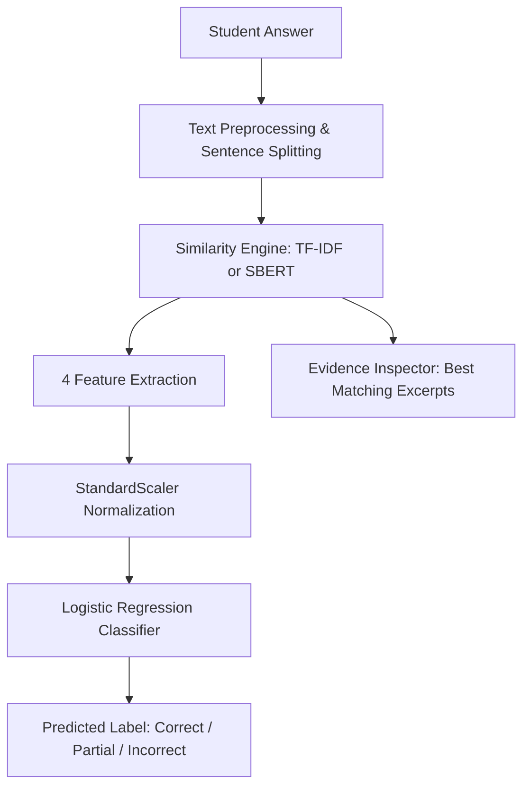

# Exam Sheet Analyzer

A machine learning and NLP-powered short answer grading and cohort diagnostic system. It evaluates student answers against a teacher's reference model answer and rubric key points, classifies responses into **correct / partial / incorrect / blank**, extracts evidence for each rubric point, and identifies class-wide misconceptions and weak subject topics.

---

## Quickstart

### 1. Setup Environment
```bash
python -m venv .venv
source .venv/bin/activate                  # Windows: .venv\Scripts\activate
pip install -r requirements.txt
```

### 2. Train Models (Optional — Pre-trained in `models/`)
```bash
# Train with TF-IDF (instant, lightweight, zero downloads)
python train.py --backend tfidf

# Train with Sentence-BERT (dense semantic embeddings via all-MiniLM-L6-v2)
python train.py --backend sbert
```

### 3. Launch Dashboard
Run the FastAPI web application using the virtual environment:
```bash
.venv/bin/python -m uvicorn main:app --reload
```
Open **[http://127.0.0.1:8000](http://127.0.0.1:8000)** in your browser.

Run automated tests:
```bash
.venv/bin/pytest -q
```

---

## Dataset Overview

The knowledge bank and labeled dataset live in [`data/`](file:///home/anushtikoo/Desktop/ML Project/Exam_Sheet_Analyzer/data):
- **Questions ([data/questions.csv](file:///home/anushtikoo/Desktop/ML Project/Exam_Sheet_Analyzer/data/questions.csv))**: 25 networking and systems questions with topic tags and teacher reference answers.
- **Rubrics ([data/rubrics.json](file:///home/anushtikoo/Desktop/ML Project/Exam_Sheet_Analyzer/data/rubrics.json))**: Breakdown of essential key points required for each question.
- **Responses ([data/responses.csv](file:///home/anushtikoo/Desktop/ML Project/Exam_Sheet_Analyzer/data/responses.csv))**: **775 labeled student responses** (750 non-blank):
  - **250 Correct**
  - **250 Partial**
  - **250 Incorrect**
  - **25 Blank** (automatically assigned `blank` without running inference)
  - All labeled responses carry a `variant_group` tag grouping rephrased variations of the same idea to prevent data leakage during validation.

---

## Machine Learning Pipeline



### The 4 Extracted Features

1. **`reference_similarity`**: Cosine similarity between the student's answer and the teacher's reference model answer.
2. **`keypoint_mean`**: Average of the highest similarity score achieved across all rubric key points. Each key point is compared against every candidate sentence in the student answer.
3. **`keypoint_min`**: The lowest score among all rubric key point matches. Acts as a **bottleneck detector** (identifies omitted concepts).
4. **`length_ratio`**: Ratio of student answer word count to model answer word count: $\min\left(\frac{\text{len}(\text{student})}{\text{len}(\text{model})}, 3.0\right)$, capped at 3.0 to prevent verbose answers from being penalized.

---

## Trained Model Weights & Decision Parameters

The classifier pipeline consists of `StandardScaler()` followed by `LogisticRegression(class_weight="balanced")`.

### 1. Sentence-BERT Engine (`models/sbert.joblib`)

* **StandardScaler Parameters**:
  * Means ($\mu$): `[ref_sim: 0.590, kp_mean: 0.445, kp_min: 0.383, length_ratio: 0.335]`
  * Scales ($\sigma$): `[ref_sim: 0.250, kp_mean: 0.218, kp_min: 0.217, length_ratio: 0.174]`

* **Logistic Regression Weights**:
  $$\text{Score}_{\text{class}} = \text{Bias} + \sum_{i=1}^{4} w_i \cdot \frac{x_i - \mu_i}{\sigma_i}$$

| Class | Bias (Intercept) | $w_1$ (`ref_sim`) | $w_2$ (`kp_mean`) | $w_3$ (`kp_min`) | $w_4$ (`length_ratio`) |
|---|---|---|---|---|---|
| **`correct`** | **$-1.263$** | **$+1.167$** | $+0.071$ | **$+1.266$** | **$+1.784$** |
| **`partial`** | **$+0.638$** | $-0.241$ | **$+0.452$** | **$-1.055$** | **$-1.150$** |
| **`incorrect`** | **$+0.625$** | **$-0.926$** | **$-0.522$** | $-0.211$ | **$-0.634$** |

#### Why These Weights Make Sense:
- **`correct`** is heavily driven by **`length_ratio` (+1.784)**, **`keypoint_min` (+1.266)**, and **`ref_sim` (+1.167)**. High rubric coverage across all key points is required.
- **`partial`** exhibits a positive weight on **`kp_mean` (+0.452)**, but a strongly negative weight on **`keypoint_min` (-1.055)**. This matches the pedagogical definition of partial credit: *the student addressed some key concepts, but has a critical omission on at least one rubric point*.
- **`incorrect`** has negative weights across all features, especially **`ref_sim` (-0.926)** and **`kp_mean` (-0.522)**.

---

### 2. TF-IDF Engine (`models/tfidf.joblib`)

* **StandardScaler Parameters**:
  * Means ($\mu$): `[ref_sim: 0.118, kp_mean: 0.105, kp_min: 0.061, length_ratio: 0.335]`
  * Scales ($\sigma$): `[ref_sim: 0.105, kp_mean: 0.125, kp_min: 0.097, length_ratio: 0.174]`

* **Logistic Regression Weights**:

| Class | Bias (Intercept) | $w_1$ (`ref_sim`) | $w_2$ (`kp_mean`) | $w_3$ (`kp_min`) | $w_4$ (`length_ratio`) |
|---|---|---|---|---|---|
| **`correct`** | **$-0.390$** | **$+0.853$** | $+0.134$ | **$+0.388$** | **$+1.330$** |
| **`partial`** | **$+0.241$** | $-0.037$ | **$+0.573$** | **$-0.959$** | **$-0.916$** |
| **`incorrect`** | **$+0.149$** | **$-0.816$** | **$-0.707$** | $+0.571$ | **$-0.414$** |

---

### 3. Comparison: 1D Similarity Baselines vs 4D Classifier

In [train.py](file:///home/anushtikoo/Desktop/ML Project/Exam_Sheet_Analyzer/train.py), simple 1D similarity cutoffs on reference similarity were evaluated as baselines:

| Backend | Baseline Low Cutoff (`incorrect`) | Baseline High Cutoff (`correct`) | Baseline Macro-F1 | 4-Feature Classifier Macro-F1 |
|---|---|---|---|---|
| **TF-IDF** | $< 0.025$ | $\ge 0.125$ | **0.554** | **0.661** (+10.7%) |
| **Sentence-BERT** | $< 0.400$ | $\ge 0.750$ | **0.578** | **0.682** (+10.4%) |

The 4-feature classifier significantly outperforms scalar similarity cutoffs because it checks individual rubric key points and penalizes missing concepts via `keypoint_min`.

---

## 5-Fold Grouped Cross-Validation Results

To prevent data leakage, evaluation uses **`GroupKFold(n_splits=5)` grouped by `variant_group`**. Paraphrased copies of an answer are guaranteed to be in either the training set or test set, but never split across both.

### Benchmark Comparison (Macro-Averaged F1)

| Model | Majority Class | Similarity Threshold Baseline | **Our 4-Feature Classifier** |
|---|---|---|---|
| **TF-IDF** | 0.321 | 0.554 | **0.661** |
| **Sentence-BERT** | 0.321 | 0.578 | **0.682** |

### Confusion Matrix (Sentence-BERT Classifier, 750 Non-Blank Responses)

```text
               Predicted:
               Incorrect  Partial  Correct
True:
Incorrect         126        88       36
Partial            75       166        9
Correct            11        16      223
```
- **High Correct Precision & Recall**: 223 of 250 correct answers (89.2% recall) are correctly identified with only 9 partials and 36 incorrects misclassified as correct.
- **Differentiating Partial vs Incorrect**: Partial credit classification achieves 166 true positives, reflecting the strong discriminative power of `keypoint_min` and `keypoint_mean`.

---

## System Architecture & Features

### 1. Interactive Web Dashboard ([static/index.html](file:///home/anushtikoo/Desktop/ML Project/Exam_Sheet_Analyzer/static/index.html))
- **Tab 1: Single Answer Grader**:
  - Real-time question selection with model answer toggle.
  - Runtime switch between **Sentence-BERT** and **TF-IDF**.
  - **Rubric Match Inspector**: Visual breakdown showing each rubric key point, similarity score, and the exact extracted evidence sentence.
- **Tab 2: Class Diagnostics**:
  - Drag-and-drop CSV upload or **1-Click "Load Demo Dataset"**.
  - **Stacked Visual Distribution Bars**: Color-coded proportions (green/orange/red) of student mastery per question.
  - **Weakest Topics Alert Cards**: Automatically aggregates failure rates across subject domains.
  - **Misconception Clustering**: Runs Agglomerative Hierarchical Clustering (`group_similar_mistakes` in [core.py](file:///home/anushtikoo/Desktop/ML Project/Exam_Sheet_Analyzer/core.py#L268)) over incorrect answers to surface recurring conceptual errors with sample student quotes.

---

## Project Structure

```text
Exam_Sheet_Analyzer/
├── core.py                   # Core ML logic: similarity, feature extraction, grading & clustering
├── main.py                   # FastAPI server: /api/questions, /api/predict, /api/analyze
├── train.py                  # Training pipeline, GroupKFold CV, baseline evaluation
├── requirements.txt          # Python dependencies
├── README.md                 # Project documentation
├── data/
│   ├── questions.csv         # 25 questions, topics, teacher model answers
│   ├── rubrics.json          # Key points per question
│   ├── responses.csv         # 775 labeled student responses
│   └── upload_template.csv   # Template for teacher CSV uploads
├── models/
│   ├── tfidf.joblib          # Trained TF-IDF + Logistic Regression model
│   └── sbert.joblib          # Trained Sentence-BERT + Logistic Regression model
├── results/
│   ├── cv_scores_tfidf.json  # 5-fold CV metrics for TF-IDF
│   ├── cv_scores_sbert.json  # 5-fold CV metrics for Sentence-BERT
│   ├── cv_predictions_*.csv  # Full out-of-fold prediction logs
├── static/
│   └── index.html            # Web dashboard (Single Grader + Class Diagnostics)
└── tests/
    └── test_core.py          # Pytest verification suite
```
